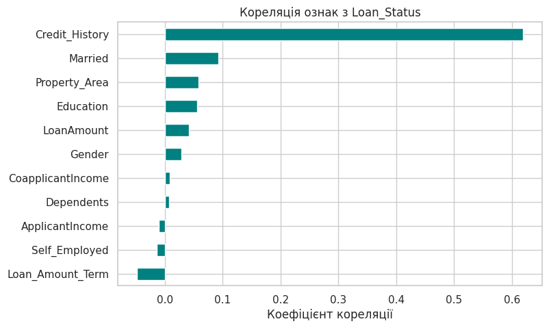
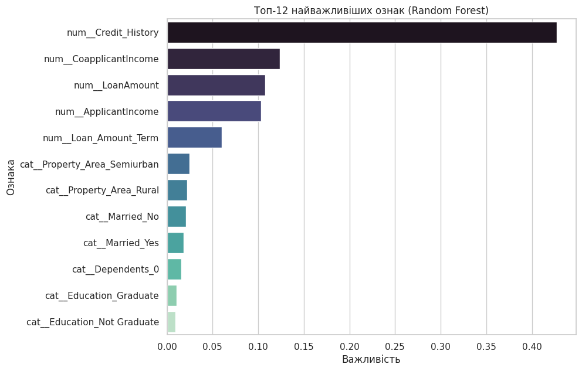
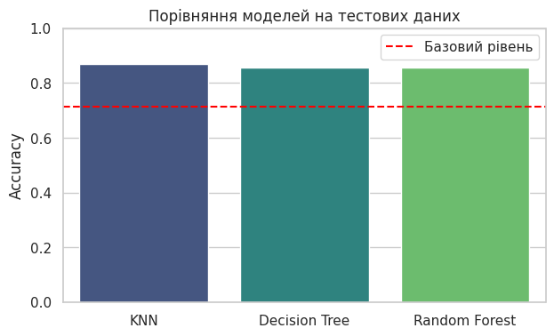
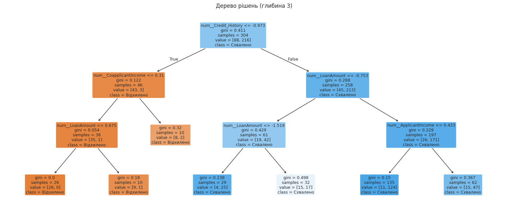

# Прогноз схвалення займу (Loan Approval Prediction)

[](https://colab.research.google.com/github/ValKar20/loan-approval-prediction/blob/main/loan_project.ipynb)

Фінальний проєкт курсу Python. За даними про клієнта (дохід, кредитна історія, сума займу тощо) модель передбачає, чи буде йому **схвалено займ**. Проєкт складається з двох частин: **Jupyter-ноутбука** (аналіз даних і навчання моделі) та **веб-застосунку на Django** (форма, прогноз, історія перевірок).

## Результати коротко

- Набір даних: **381 заявка**, 13 колонок. Схвалено 71%, відхилено 29%.
- Навчено 3 моделі: **KNN**, **Decision Tree**, **Random Forest**. Дані розділено 80/20, параметри підібрано через `GridSearchCV` з 5-кратною перехресною валідацією.
- Точність на тестових даних **86–87%** при базовому рівні 71% (якщо завжди відповідати «схвалено»).
- **Найважливіша ознака — кредитна історія** (`Credit_History`).
- Веб-застосунок на Django з трьома сторінками: «Перевірити займ», «Історія перевірок», «Як це працює».

| Модель | Accuracy (крос-валідація) | Accuracy (тест) |
|---|---|---|
| KNN | 0.842 | **0.870** |
| Decision Tree | 0.842 | 0.857 |
| Random Forest | 0.842 | 0.857 |

## Головні висновки

**1. Кредитна історія визначає рішення.** Її кореляція з результатом становить 0.62, а в усіх інших ознак менше 0.1. Схвалення отримують 82% клієнтів з хорошою кредитною історією і лише 5% тих, у кого її немає.



**2. Random Forest підтверджує це.** Важливість ознак показує те саме, що й кореляції.



**3. Усі моделі показують схожу якість.** Тестова вибірка мала (77 клієнтів), тому різниця між моделями несуттєва.



**4. Дерево рішень наочно показує логіку.**



## Веб-застосунок

Папка [`webapp/`](webapp) містить сайт на Django:

- **Перевірити займ** — форма з перевіркою введених значень і результат з імовірністю схвалення.
- **Історія перевірок** — усі збережені прогнози та коротка статистика.
- **Як це працює** — опис сервісу, технологій і обмежень.

Форма приймає лише значення в межах, на яких навчалась модель: поза цими межами прогноз був би ненадійним (наприклад, сума займу вказується в тисячах і не перевищує 200).

## Обмеження

- Мало даних (381 рядок), тому результати можуть змінюватися при іншому розділенні.
- Модель добре визначає схвалені заявки, але частину відхилених пропускає (recall для класу «Відхилено» близько 50–55%).
- Навчальний проєкт: модель не варто використовувати для реальних кредитних рішень.

## Як виконано проєкт

| Етап | Технології |
|---|---|
| Завантаження й аналіз даних (EDA): пропуски, розподіли, кореляції | `pandas` |
| Графіки | `matplotlib`, `seaborn` |
| Розділення даних 80/20 | `scikit-learn` (`train_test_split`) |
| Обробка даних: заповнення пропусків, масштабування, кодування категорій | `SimpleImputer`, `StandardScaler`, `OneHotEncoder`, `ColumnTransformer` |
| Моделі | `KNeighborsClassifier`, `DecisionTreeClassifier`, `RandomForestClassifier` |
| Підбір параметрів і перехресна валідація | `Pipeline`, `GridSearchCV` |
| Оцінка якості | accuracy, precision, recall, F1, матриця помилок |
| Збереження моделі | `joblib` |
| Веб-застосунок: форма, перевірка даних, база даних, сторінки | `Django` (Models, Forms, Views, Templates), SQLite |

## Як запустити

**Ноутбук у Google Colab (найпростіше).** Натисніть кнопку «Open In Colab» угорі, виберіть Runtime → Run all і, коли з'явиться кнопка Choose files, завантажте файл `loan_data.csv` з цього репозиторію.

**Ноутбук на своєму комп'ютері.**
```bash
git clone https://github.com/ValKar20/loan-approval-prediction.git
cd loan-approval-prediction
pip3 install -r requirements.txt
jupyter notebook loan_project.ipynb
```

**Веб-застосунок (Mac / Linux).**
```bash
cd loan-approval-prediction/webapp
bash run.sh
```
Скрипт сам створить окреме середовище, встановить бібліотеки, навчить модель і запустить сайт. Після цього відкрийте http://127.0.0.1:8000/ (зупинити: Ctrl + C).

## Структура репозиторію

```
loan-approval-prediction/
├── loan_project.ipynb   # ноутбук: частина 1 (EDA) і частина 2 (моделювання)
├── loan_data.csv        # дані
├── images/              # графіки для README
├── requirements.txt     # бібліотеки для ноутбука
├── webapp/              # веб-застосунок на Django
│   ├── run.sh           # запуск одним скриптом
│   ├── train_model.py   # навчання і збереження моделі
│   ├── predictor/       # застосунок: моделі, форми, в'юхи, шаблони
│   └── loan_site/       # налаштування проєкту
└── README.md
```

## Автор

[Karman Valentyn] — [diriienko333@gmail.com]
